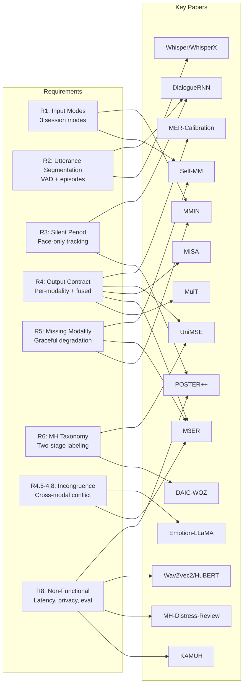
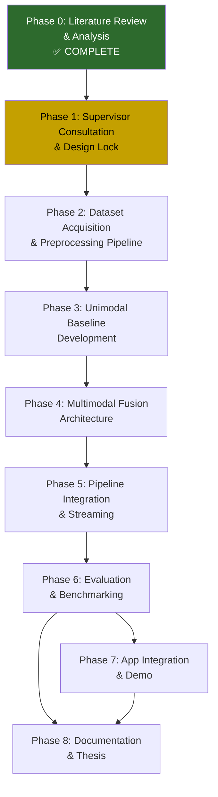
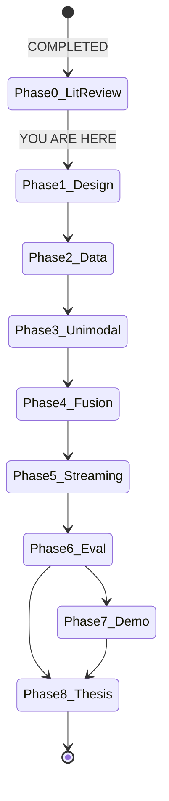

# Multimodal Emotion Recognition Pipeline
## ML Development Lifecycle Plan & Curated Paper Analysis

**Project:** AI-Based Mental Health Emotion Monitoring from Facial and Voice Features Using Multimodal AI
**Date:** September 2026
**Current Phase:** Phase 0 — Analysis (Requirements set, Feasibility confirmed)
**Purpose:** Supervisor-ready document mapping 59 reviewed papers → requirements → development plan

---

## Table of Contents

1. [Requirements Summary](#1-requirements-summary)
2. [Paper Curation: Tier Classification](#2-paper-curation-tier-classification)
3. [Requirement → Paper Mapping Matrix](#3-requirement--paper-mapping-matrix)
4. [ML Development Lifecycle (MLDLC)](#4-ml-development-lifecycle-mldlc)
5. [Current Position & Immediate Next Steps](#5-current-position--immediate-next-steps)
6. [Best-Case Development Flow Timeline](#6-best-case-development-flow-timeline)
7. [Risk Register & Mitigation](#7-risk-register--mitigation)
8. [Open Decisions for Supervisor Meeting](#8-open-decisions-for-supervisor-meeting)

---

## 1. Requirements Summary

The [Multimodal_Emotion_Pipeline_Requirements_Specification.docx](file:///F:/__Projects/_Research/Sys_Mental_health/Multimodal_Emotion_Pipeline_Requirements_Specification.docx) defines **9 major requirement areas**. Here's the distilled version:

| Req Area | Core Mandate | Key Requirement IDs |
|---|---|---|
| **Input Modes** | 3 session modes (full multimodal, voice+text, text-only) as first-class, not degraded | R1.1–R1.3 |
| **Temporal Granularity** | Utterance = core unit; VAD + pause segmentation; episode linking for interrupted thoughts | R2.1–R2.8 |
| **Silent Periods** | Face-only tracking during silence; resting vs. speaking face comparison (novel angle) | R3.1–R3.4 |
| **Output Contract** | Per-modality + fused labels, per-signal confidence, modality-contribution weights | R4.1–R4.4 |
| **Incongruence** | Detect cross-modal disagreement (calm words + distressed face/voice); explicit flag | R4.5–R4.8 |
| **Missing Modality** | Whole-session absence (deliberate) vs. mid-session drop (transient) — distinct handling | R5.1–R5.5 |
| **Emotion Taxonomy** | Mental-health-oriented labels via two-stage pipeline: generic pretrain → MH mapping | R6.1–R6.5 |
| **Non-Functional** | Streaming/near-real-time, on-device privacy, separate FN/FP evaluation, scope disclaimer | R8.1–R8.7 |
| **Architecture** | Classifier+fusion first (MVP), LLM reasoning as Phase 2 upgrade | Section 7 |

> [!IMPORTANT]
> The requirements spec explicitly recommends: **build the classifier+fusion pipeline first** (lower risk, satisfies bulk of requirements), then **layer LLM-based reasoning as Phase 2** — which matches the original proposal's "Future Extensions" framing.

---

## 2. Paper Curation: Tier Classification

Out of 59 papers reviewed, here's the breakdown by direct relevance to the requirements spec:

### Tier 1 — MUST-CITE / MUST-USE (20 papers)
These papers **directly inform architecture decisions, borrowed components, or evaluation protocol**. You will cite these most heavily and borrow code/methodology from them.

| # | Paper ID | Title | Why It's Tier 1 (Requirement Link) |
|---|---|---|---|
| 1 | **MulT** | Multimodal Transformer for Unaligned Multimodal Language Sequences | **Core fusion template** — cross-modal attention backbone for HEAD-A (R4.1–R4.4). The cross-attention pattern lets each modality attend to every other without forced alignment. |
| 2 | **M3ER** | Multiplicative Multimodal Emotion Recognition | **Modality reliability gating** (R4.3, R4.4, R5.3). Multiplicative fusion suppresses corrupted modalities per-sample — exactly what R5.3 (transient drops) needs. |
| 3 | **MISA** | Modality-Invariant and -Specific Representations | **Disentanglement for speaker independence** (R4.4, R8.5). Separates identity/channel noise from affect — critical for speaker-independent MH monitoring. |
| 4 | **Self-MM** | Learning Modality-Specific Representations with Self-Supervised Multi-Task Learning | **Self-supervised unimodal objectives** (R4.1, R5.1–R5.2). Pseudo unimodal labels make each encoder independently competent — directly supports mode-specific operation. |
| 5 | **UniMSE** | Unified Multimodal Sentiment Analysis and Emotion Recognition | **Dual-head blueprint** (R4.1, R6.4). One backbone serving both categorical emotions AND dimensional intensity — exactly the output contract needs. |
| 6 | **DialogueRNN** | An Attentive RNN for Emotion Detection in Conversation | **Session-level temporal modeling** (R2.5–R2.8, R3.2). Adapt the speaker-state GRU to single-user mood drift across utterances/silences. |
| 7 | **Emotion-LLaMA** | Multimodal Emotion Recognition and Reasoning with Instruction Tuning | **Phase 2 explainability head template** (R4.7). Direct template for labels + natural-language rationale generation. |
| 8 | **AffectGPT** | Dataset, Model, and Benchmark for Multimodal Emotion Recognition and Reasoning | **Reasoning evaluation** (R4.7, R8.5). Benchmark for measuring explanation quality beyond just label accuracy. |
| 9 | **MERBench** | Unified Evaluation Benchmark for MER in the Wild | **Evaluation protocol** (R8.5–R8.6). Adopt its standardized splits and metrics so ablation comparisons are credible. |
| 10 | **KAMUH** | Real-Time Online Audiovisual Emotion Recognition System | **Streaming architecture reference** (R8.1–R8.2). Closest deployment reference: proves utterance-level MER under latency constraints. |
| 11 | **Wav2Vec2** | Framework for Self-Supervised Learning of Speech Representations | **Primary voice encoder** (R4.1 voice branch). Default pretrained backbone; fine-tune on RAVDESS/CREMA-D. |
| 12 | **HuBERT** | Hidden-Unit BERT for Speech | **Alternative voice encoder for ablation** (R4.1). Compare against Wav2Vec2 — may capture prosody better for distress cues. |
| 13 | **Whisper** | Robust Speech Recognition via Large-Scale Weak Supervision | **Transcript stream + utterance segmentation** (R2.1–R2.4). WhisperX provides word-level timestamps for the streaming pipeline. |
| 14 | **POSTER++** | A Simpler and Stronger Facial Expression Recognition Network | **Primary face encoder** (R4.1 face branch). Strong RAF-DB/AffectNet performance, manageable size for real-time use. |
| 15 | **MMIN** | Missing Modality Imagination Network | **Core missing-modality handler** (R5.1–R5.4). Learns to hallucinate missing-modality features with cycle-consistency — graceful degradation when camera/mic drops. |
| 16 | **MER-Calibration** | Multimodal Emotion Recognition Calibration in Conversations | **Confidence calibration** (R4.3, R6.5). Post-hoc calibration is a *safety requirement* — uncalibrated scores mislead users about their own state. |
| 17 | **DAIC-WOZ-Paper** | The Distress Analysis Interview Corpus | **Clinical bridge dataset** (R6.2). The ONLY corpus with validated depression labels — essential for Stage-2 generic→MH mapping. |
| 18 | **Mental-Health-Distress-Review** | Systematic Review on Automated Multimodal Mental Health and Distress Detection | **Primary citation for privacy chapter + gap claims** (R8.3–R8.4). Identifies federated learning, DP, on-device inference as viable privacy stack. |
| 19 | **MER-Mega-Survey-2026** | Survey on Multimodal Emotion Recognition | **Justifies attention-based fusion choice** over concatenation (R4.2, R4.4). Declares "effective fusion design remains open." |
| 20 | **SER-Mega-Review-2026** | Speech Emotion Recognition: Comprehensive Survey of Modern Architectures | **Justifies SSL encoders over MFCC+LSTM** (voice branch). Establishes SSL + speaker-independence as the deployment baseline. |

### Tier 2 — CONDITIONALLY IMPORTANT (20 papers)
These are **important depending on implementation choices**. You'll use a subset based on which specific design paths you take.

| # | Paper ID | Condition When It Becomes Critical |
|---|---|---|
| 1 | **MMIM** | If text modality dominates and starves face/voice gradients during fusion training |
| 2 | **TFN** | As baseline comparison in thesis ablation table (must-beat reference) |
| 3 | **LMF** | If transformer fusion is too heavy for on-device; low-rank fallback |
| 4 | **MAG-BERT** | If you need to inject nonverbal context into a frozen language model cheaply |
| 5 | **Noise-Resistant-MMT** | If real-world audio/visual noise degrades fusion — noise-aware attention filtering |
| 6 | **Self-Attention-Incomplete** | Alternative missing-modality strategy to MMIN (simpler but less capable) |
| 7 | **IF-MMIN** | If MMIN hallucinations are plausible-but-wrong — MI constraints for safer imagination |
| 8 | **M3S** | Training recipe for robustness evaluation (meta-sampling diverse missingness patterns) |
| 9 | **VAE-Diffusion-MER** | SOTA missing-modality at high missing rates (70%), but needs streaming validation |
| 10 | **EMER** | Ensemble with dynamic modality weights — weights double as dashboard confidence bars |
| 11 | **CubeMLP** | If pure-MLP mixing is needed for on-device (linear-time, tiny, competitive) |
| 12 | **DialogueGCN** | If graph-based session modeling outperforms GRU for mood trajectories |
| 13 | **COSMIC** | If commonsense reasoning improves explainability ("intent, reaction, effect") |
| 14 | **OpenFace2** | If AU time-series needed for explainable reports ("AU4 brow-lowering elevated") |
| 15 | **MediaPipe-Face** | Default mobile face front-end (on-device privacy, sub-frame latency) |
| 16 | **WavLM** | If deployment environment is noisy (built-in denoising from pretraining) |
| 17 | **openSMILE-eGeMAPS** | Interpretable voice baseline (thesis requirement: MFCC/pitch/spectral) |
| 18 | **AVEC-Challenges** | Evaluation protocol reference — hidden-split discipline keeps claims credible |
| 19 | **FER-Survey-2026** | Supports ViT face encoder choice and micro-expression future-work item |
| 20 | **M-SENA** | Experiment harness for face-only / voice-only / fused ablations |

### Tier 3 — BACKGROUND / SURVEY (19 papers)
These are **cited in the literature review chapter only**. Read for context, skim for methodology vocabulary.

| Papers | Role |
|---|---|
| MFN, M2FNet, Fusing-Pairwise, DialogueCRN, GS-MCC | Conversational/fusion variants — cite as related work, not direct implementation sources |
| FDFNet, EMOE, Centering-Emotion-Hotspots | Specialized extensions (hotspot localization, MoE) — future work citations |
| MicroEmo, EmoFusion, TITAN | Micro-expression, anchor attention, alignment — stretch goals only |
| DAN, ARM | Alternative FER backbones — only if POSTER++ underperforms |
| DepAudioNet, Deep-Multimodal-Depression | Depression-specific baselines — cite in MH chapter, not primary methodology |
| Rouast-Survey, Gandhi-Survey, Baltrusaitis-Survey, Schuller-Affect-Survey | Foundational taxonomies — Chapter 2 citations |

> [!TIP]
> **For the supervisor meeting**: Present the 20 Tier 1 papers as "these are the ones we're building on." Show the Tier 2 list as "these are our design choices — we pick from these based on our specific constraints." Mention Tier 3 exists for the lit review chapter.

---

## 3. Requirement → Paper Mapping Matrix

This maps each major requirement area to the specific papers that solve it:



### Detailed Requirement → Paper Matrix

| Requirement | Primary Paper(s) | What You Borrow |
|---|---|---|
| **R1.1** Mode as first-class input | Self-MM, MMIN | Self-supervised unimodal objectives (each encoder works alone); imagination for missing modality |
| **R1.2** Report which modalities used | M3ER | Modality-reliability gating naturally outputs which modalities contributed |
| **R1.3** Text-only as valid path | Self-MM | Unimodal text head is independently trained |
| **R2.1–R2.4** Utterance segmentation | Whisper/WhisperX | Word-level timestamps → pause detection; VAD + ASR boundary refinement |
| **R2.5–R2.6** Episode linking | DialogueRNN | Speaker-state GRU tracks continuity across gaps; adapt to single-user |
| **R2.7** Silent-period face tracking | POSTER++ | Face encoder runs independently; output tagged as `silent-facial` segment |
| **R2.8** Session aggregation | DialogueRNN, UniMSE | Context GRU for session trajectory + dual categorical/dimensional output |
| **R3.1–R3.2** Resting vs speaking face | POSTER++, DialogueRNN | Compare face-branch output with/without concurrent voice — novel contribution |
| **R4.1** Per-modality signal | MulT, MISA | Cross-modal attention preserves per-branch outputs before fusion |
| **R4.2** Fused output | MulT, MISA, M3ER | Attention + disentanglement + reliability gating |
| **R4.3** Per-signal confidence | MER-Calibration | Post-hoc calibration layer on each branch + fused output |
| **R4.4** Modality contribution weights | M3ER, EMER | Reliability gate outputs = contribution weights for dashboard |
| **R4.5–R4.6** Incongruence (classifier) | M3ER + rule layer | When gate weights diverge sharply → explicit incongruence flag |
| **R4.7** Incongruence (LLM path) | Emotion-LLaMA | Natural-language explanation of detected incongruence (Phase 2) |
| **R4.8** Fixed emotion label set | — (design decision) | Defined in R6, see taxonomy section |
| **R5.1** Session-absent modality | Self-MM, MMIN | Unimodal fallback paths; explicit `not-available` tag |
| **R5.3** Transient drop | MMIN, M3S | Imagination + meta-sampling training for diverse missingness |
| **R5.4** Confidence lowering on drop | MER-Calibration | Calibrated confidence naturally lowers when input is imagined |
| **R6.1–R6.3** Two-stage labeling | DAIC-WOZ, UniMSE | Stage 1: generic emotions + VA on public data. Stage 2: mapping layer fine-tuned on DAIC-WOZ |
| **R6.4** Dimensional scores | UniMSE, AffectNet (dataset) | VA heads from UniMSE; AffectNet provides VA training labels |
| **R6.5** Neutral fallback | MER-Calibration | Low-confidence → "insufficient signal" instead of forced label |
| **R8.1** Streaming | KAMUH | Online segmentation + incremental inference pattern |
| **R8.2** Sub-second latency | KAMUH, CubeMLP | KAMUH proves feasibility; CubeMLP as lightweight fallback |
| **R8.3–R8.4** Privacy / on-device | MH-Distress-Review, MediaPipe | Federated learning + DP stack; MediaPipe for on-device face |
| **R8.5** Real-world evaluation | MERBench, AVEC-Challenges | Standardized protocol + hidden-split discipline |
| **R8.6** Asymmetric FN/FP | — (novel evaluation) | No paper does this exactly — this is a **research contribution** |

---

## 4. ML Development Lifecycle (MLDLC)



### Phase 0: Literature Review & Analysis ✅ COMPLETE

**Status:** Done. 59 papers cataloged, 15 datasets identified, 13 tools mapped, 8 challenges documented.

**Deliverables produced:**
- 5 PDF volumes (Master + 4 topic volumes)
- [curated_data.py](file:///F:/__Projects/_Research/Sys_Mental_health/curated_data.py) — programmatic access to all 59 papers
- This document (curated papers + MLDLC plan)

---

### Phase 1: Supervisor Consultation & Design Lock ← **YOU ARE HERE**

**Objective:** Get supervisor buy-in on architecture, scope, and timeline before writing a single line of model code.

**Deliverables:**
| # | Deliverable | Description |
|---|---|---|
| 1.1 | **Architecture Decision Document** | Classifier+fusion (MVP) vs. LLM (Phase 2). Present the requirements spec Section 7 table to supervisor. |
| 1.2 | **Emotion Taxonomy Decision** | Lock the label set per R6.1. Suggested: {Content/Calm, Happy/Positive, Sad/Low-Mood, Anxious/Stressed, Angry/Frustrated, Fearful/Overwhelmed, Confused/Uncertain, Neutral/Flat}. 8 labels max. |
| 1.3 | **Scope Boundary Document** | What's MVP vs. what's "Future Extensions." Specifically: gaze estimation (out), multi-person (out), LLM reasoning (Phase 2), wearables (future). |
| 1.4 | **Dataset Access Plan** | Which datasets need license requests (IEMOCAP, AffectNet, DAIC-WOZ, ABAW) — start NOW, approvals take weeks. |
| 1.5 | **Custom Dataset Pilot Plan** | Decide scale: 5–10 volunteers, ~30min each = ~5 hours. Define annotation protocol (R6.3). |

**Key Decisions to Make with Supervisor:**
1. Is the two-stage labeling approach (R6.2) rule-based or learned? Rule-based is faster and more defensible for a system-design report.
2. How much custom data is "enough" for a believable pilot? (R9, open question)
3. Is single-user assumption acceptable for MVP? (R1.9 / R9, open question)
4. Incongruence threshold — hand-label a small validation set or defer to empirical tuning?

> [!WARNING]
> **Start dataset access requests IMMEDIATELY.** IEMOCAP, AffectNet, and especially DAIC-WOZ require institutional agreements that can take 2–6 weeks. Don't let this become a timeline blocker.

---

### Phase 2: Dataset Acquisition & Preprocessing Pipeline

**Objective:** Have all data downloaded, preprocessed, and ready in a unified format before model training begins.

**Deliverables:**
| # | Deliverable | Papers Referenced |
|---|---|---|
| 2.1 | **Data Download & Verification** | All publicly available datasets (FER2013, RAVDESS, CREMA-D, MELD, DFEW) + licensed ones |
| 2.2 | **Face Preprocessing Pipeline** | Face detection → alignment → cropping → normalization. Use MTCNN/RetinaFace. Reference: POSTER++ preprocessing |
| 2.3 | **Voice Preprocessing Pipeline** | 16kHz resample → noise normalization → segment extraction. Reference: Wav2Vec2 recipes from S3PRL |
| 2.4 | **Transcript Pipeline** | WhisperX for word-level timestamps + VAD segmentation (R2.1–R2.4) |
| 2.5 | **Unified Data Loader** | PyTorch DataLoader that handles all 3 modalities + missing-modality masking (R5.1). Reference: CMU-MultimodalSDK format |
| 2.6 | **Speaker-Independent Split Generation** | Leave-speakers-out splits for RAVDESS, CREMA-D, IEMOCAP (R8.5). Reference: DeepSeek 13% drop finding |
| 2.7 | **Custom Dataset Collection Setup** | Recording protocol, consent forms, annotation guidelines for the pilot |

**Tools:**
- WhisperX for transcript + timestamps
- openSMILE/eGeMAPS for interpretable features
- MediaPipe or MTCNN for face detection
- S3PRL for voice encoder recipes

---

### Phase 3: Unimodal Baseline Development

**Objective:** Each modality branch works independently and has published-comparable numbers before fusion.

**Deliverables:**
| # | Deliverable | Architecture | Benchmark Target | Papers Referenced |
|---|---|---|---|---|
| 3.1 | **Face Encoder** | POSTER++ (primary) or ViT-base | AffectNet: ~63% acc (8-class), RAF-DB: ~92% acc | POSTER++, FER-Survey-2026 |
| 3.2 | **Voice Encoder** | Wav2Vec2-base fine-tuned | RAVDESS: ~73% WF1 (speaker-ind.), CREMA-D: ~65% WF1 | Wav2Vec2, HuBERT, SER-Mega-Review-2026 |
| 3.3 | **Voice Baseline (interpretable)** | eGeMAPS + SVM/MLP | RAVDESS: ~55% WF1 (speaker-ind.) | openSMILE-eGeMAPS |
| 3.4 | **Text Encoder** | BERT-base or RoBERTa fine-tuned | GoEmotions: ~50% macro-F1 (27-class) | Self-MM (text head), GoEmotions dataset |
| 3.5 | **HuBERT Ablation** | HuBERT-base fine-tuned | Same splits as 3.2 for direct comparison | HuBERT |

> [!NOTE]
> **The thesis requirement** (R4.1, idea.docx Section 4.1) explicitly demands a comparative analysis between facial-only, voice-only, and multimodal. These unimodal baselines are not throwaway — they're a required deliverable.

**Success Criteria:** Each unimodal branch hits within 5% of published results on standard benchmarks with speaker-independent splits.

---

### Phase 4: Multimodal Fusion Architecture (HEAD-A)

**Objective:** Build the discriminative fusion head that satisfies R4.1–R4.8.

**Architecture Blueprint:**

```
┌─────────────┐  ┌─────────────┐  ┌─────────────┐
│  Face Branch │  │ Voice Branch │  │ Text Branch  │
│  (POSTER++)  │  │  (Wav2Vec2)  │  │   (BERT)     │
└──────┬──────┘  └──────┬──────┘  └──────┬──────┘
       │                │                │
       ▼                ▼                ▼
┌──────────────────────────────────────────────────┐
│         MISA Disentanglement Layer               │
│  (shared invariant + private specific subspaces) │
└──────────────────────┬───────────────────────────┘
                       │
                       ▼
┌──────────────────────────────────────────────────┐
│        MulT Cross-Modal Attention                │
│  (pairwise: F↔V, F↔T, V↔T + self-attention)    │
└──────────────────────┬───────────────────────────┘
                       │
                       ▼
┌──────────────────────────────────────────────────┐
│        M3ER Reliability Gating                   │
│  (modality check → multiplicative fusion)        │
│  Output: per-modality weights (→ R4.4)           │
└──────────────────────┬───────────────────────────┘
                       │
                       ▼
┌──────────────────────────────────────────────────┐
│        Prediction Heads                          │
│  • Categorical: 8 MH-oriented emotions (R6.1)   │
│  • Dimensional: Valence + Arousal (R6.4)         │
│  • Incongruence: cross-modal divergence (R4.5)   │
└──────────────────────┬───────────────────────────┘
                       │
                       ▼
┌──────────────────────────────────────────────────┐
│        MER-Calibration Layer                     │
│  (post-hoc confidence calibration per branch)    │
│  Output: calibrated scores (→ R4.3, R6.5)       │
└──────────────────────────────────────────────────┘
```

**Deliverables:**
| # | Deliverable | Papers Referenced |
|---|---|---|
| 4.1 | **MISA disentanglement integration** | MISA |
| 4.2 | **MulT cross-modal attention** | MulT |
| 4.3 | **M3ER reliability gating** | M3ER |
| 4.4 | **Missing-modality training with MMIN** | MMIN, M3S |
| 4.5 | **Dual prediction heads** (categorical + VA) | UniMSE |
| 4.6 | **Incongruence detection module** | M3ER (gate divergence), rule-based threshold |
| 4.7 | **Calibration layer** | MER-Calibration |
| 4.8 | **Fusion benchmark** | CMU-MOSEI: beat MulT baseline; IEMOCAP: match MISA numbers |

**Training Strategy:**
1. Freeze all encoders, train fusion layers only on IEMOCAP/MOSEI (2–3 epochs)
2. Unfreeze encoders with 10× lower LR, fine-tune end-to-end (3–5 epochs)
3. MMIN missing-modality training: random modality dropout during step 2
4. Calibration: train on validation set predictions post-training

---

### Phase 5: Pipeline Integration & Streaming

**Objective:** Turn the batch model into a streaming pipeline that satisfies R2.1–R2.8 and R8.1–R8.2.

**Deliverables:**
| # | Deliverable | Papers Referenced |
|---|---|---|
| 5.1 | **VAD + Utterance Segmenter** | Whisper/WhisperX + Silero VAD |
| 5.2 | **Episode Linker** (R2.5–R2.6) | DialogueRNN (adapt GRU), heuristic pause classification |
| 5.3 | **Silent-Period Face Tracker** (R3.1) | POSTER++ running independently; tagged output |
| 5.4 | **Streaming Pipeline Orchestrator** | KAMUH reference; 3-second rolling audio windows |
| 5.5 | **Session-Level Aggregation** (R2.8) | DialogueRNN context GRU for trajectory |
| 5.6 | **Mode Router** (R1.1–R1.3) | Routes to correct processing path based on available modalities |
| 5.7 | **Latency Benchmarking** | Target: ≤1s end-to-end per utterance (R8.2) |

**Latency Budget:**
| Component | Target | Fallback |
|---|---|---|
| Face detect+encode | ≤40ms | MediaPipe mesh |
| Voice window (3s roll) | ≤300ms | Wav2Vec2-base distilled |
| Cross-modal fusion | ≤120ms | LMF if MulT too slow |
| ASR partial | ≤500ms | FunASR alternative |
| End-to-end | ≤1s | Heads A+B decoupled |

---

### Phase 6: Evaluation & Benchmarking

**Objective:** Produce credible, publishable evaluation results per R8.5–R8.6.

**Evaluation Matrix:**
| Evaluation | Datasets | Metrics | Papers Referenced |
|---|---|---|---|
| Face-only vs. voice-only vs. fused | FER2013, AffectNet, RAVDESS, CREMA-D | Acc, macro-F1, per-class F1, confusion matrix | MERBench protocol |
| Speaker independence | Leave-speakers-out splits | WF1 gap vs. random (must report) | DeepSeek 13% warning |
| Missing-modality robustness | Camera-off / mic-off / intermittent | Acc@missing-rate curve | MMIN, M3S, MissBench |
| Real-world robustness | Custom set: lighting × noise × style | Stratified F1 + latency percentiles | AVEC-Challenges protocol |
| Calibration quality | Reliability diagrams | ECE < 0.05 | MER-Calibration |
| Asymmetric FN/FP (R8.6) | All sets | Separate FN rate (missed distress) and FP rate (false alarm) | **Novel contribution** — no paper does this |
| Incongruence detection | Hand-labeled subset | Precision/recall on flagged segments | Rule-based evaluation |

> [!IMPORTANT]
> **R8.6 (asymmetric FN/FP evaluation) is a genuine research contribution.** No reviewed paper evaluates false-negative vs. false-positive separately for mental-health emotion recognition. This is worth emphasizing to the supervisor.

---

### Phase 7: App Integration & Demo

**Objective:** Integrate the pipeline into a working demo (web or mobile).

**Deliverables:**
| # | Deliverable |
|---|---|
| 7.1 | **REST API / WebSocket endpoint** wrapping the streaming pipeline |
| 7.2 | **Frontend dashboard** — emotion history, trend lines, confidence bars, incongruence flags |
| 7.3 | **Session replay** with per-utterance emotion overlay |
| 7.4 | **Privacy disclosure** and scope disclaimer (R8.7) |

**Note:** This phase can overlap with Phase 6. The demo doesn't need to be production-quality — it needs to demonstrate the pipeline works end-to-end.

---

### Phase 8: Documentation & Thesis

**Deliverables:**
| # | Chapter / Section |
|---|---|
| 8.1 | **Chapter 1: Introduction** — cite Baltrusaitis-Survey, mental health statistics |
| 8.2 | **Chapter 2: Literature Review** — Tier 1+2 papers, organized by requirement area |
| 8.3 | **Chapter 3: Methodology** — architecture diagram, training protocol, two-stage labeling justification |
| 8.4 | **Chapter 4: Implementation** — pipeline details, code architecture, streaming design |
| 8.5 | **Chapter 5: Evaluation** — full results from Phase 6, asymmetric FN/FP analysis |
| 8.6 | **Chapter 6: Discussion** — what worked, what didn't, comparison with KAMUH/MulT baselines |
| 8.7 | **Chapter 7: Conclusion & Future Work** — LLM reasoning head (Phase 2), wearables, micro-expressions |

---

## 5. Current Position & Immediate Next Steps



### Immediate Action Items (This Week)

| Priority | Action | Why Now |
|---|---|---|
| 🔴 | **Submit dataset access requests** (IEMOCAP, AffectNet, DAIC-WOZ, ABAW) | 2–6 week approval delay |
| 🔴 | **Schedule supervisor meeting** with this document | Design lock blocks everything |
| 🟡 | **Lock emotion taxonomy** (8 labels) | Affects all training pipelines |
| 🟡 | **Decide: rule-based vs. learned Stage-2 mapping** (R6.3) | Highest-leverage scoping decision |
| 🟢 | **Download freely available datasets** (FER2013, RAVDESS, CREMA-D, MELD, DFEW, GoEmotions) | No approval needed, start preprocessing |
| 🟢 | **Set up experiment repo** (PyTorch, Hydra config, W&B logging) | Infrastructure before model code |

---

## 6. Best-Case Development Flow Timeline

> [!CAUTION]
> This is a **best-case** estimate assuming full-time work and no major blockers. Real timelines depend on dataset approvals, compute availability, and supervisor feedback cycles.

| Week | Phase | Key Milestone |
|---|---|---|
| W1–W2 | **Phase 1** | Supervisor sign-off, design locked, taxonomy finalized |
| W2–W4 | **Phase 2** | All datasets downloaded, preprocessing pipelines complete, data loaders tested |
| W4–W7 | **Phase 3** | Face encoder (POSTER++) + Voice encoder (Wav2Vec2) + Text encoder (BERT) trained, numbers match published |
| W7–W10 | **Phase 4** | Fusion architecture (MulT + MISA + M3ER + calibration) trained, beats unimodal baselines on MOSEI/IEMOCAP |
| W10–W12 | **Phase 5** | Streaming pipeline running end-to-end, ≤1s per utterance |
| W12–W14 | **Phase 6** | Full evaluation matrix complete, including custom-data pilot |
| W14–W16 | **Phase 7** | Demo app functional |
| W14–W18 | **Phase 8** | Thesis drafted and reviewed |

**Total: ~18 weeks (4.5 months) best case**

---

## 7. Risk Register & Mitigation

| Risk | Impact | Likelihood | Mitigation |
|---|---|---|---|
| DAIC-WOZ access denied/delayed | Blocks Stage-2 MH mapping (R6.2) | Medium | Use rule-based mapping as fallback; DAIC-WOZ is "nice to have" not "must have" for MVP |
| Speaker-independent accuracy too low | Thesis results look weak | High | Report the gap honestly (it's a known finding); use domain adaptation techniques |
| Fusion doesn't beat best unimodal | Core claim undermined | Medium | This IS a valid finding if properly analyzed. Ensure unimodal baselines are strong. |
| Streaming latency exceeds budget | R8.1–R8.2 violated | Low-Medium | LMF/CubeMLP as lightweight fusion fallbacks; distill voice encoder |
| Custom dataset too small | Pilot evaluation not believable | High | Define minimum viable scale with supervisor (5 volunteers × 30min = 2.5h minimum) |
| POSTER++ underperforms on custom data | Face branch weak | Low | Fallback to DAN or fine-tuned ViT-base |

---

## 8. Open Decisions for Supervisor Meeting

These are the **exact questions to bring to the supervisor**:

### Decision 1: Stage-2 Label Mapping Approach
- **Option A: Rule-based** (fast, transparent, easier to justify in report)
  - Map valence-arousal quadrants → MH labels using threshold rules
  - Pro: Immediate, no extra data needed, fully explainable
  - Con: Crude, may not capture nuanced states well
- **Option B: Learned mapping** (more accurate, adds data collection task)
  - Small fine-tuning dataset with MH-specific annotations
  - Pro: More accurate, publishable contribution
  - Con: Need to collect/annotate data first

> **Recommendation:** Start with Option A for MVP, upgrade to Option B if time permits. This is the spec's own recommendation (Section 9).

### Decision 2: Custom Dataset Scale
- Minimum viable: 5 volunteers × 30min = 2.5 hours
- Recommended: 10 volunteers × 30min = 5 hours
- Ideal: 20+ volunteers with demographic diversity

### Decision 3: Single-User Assumption
- **Recommendation:** Assume single face/voice per session for MVP (R9, open question). Multi-person adds face re-identification and diarization complexity.

### Decision 4: Gaze Estimation for Gap Annotation
- R2.6 stretch goal: infer *reason* for an interruption gap from gaze/attention
- **Recommendation:** Explicitly out of scope for MVP. Log gap duration only.

### Decision 5: LLM Reasoning Head Timeline
- The spec recommends this as Phase 2 after classifier pipeline is working
- **Recommendation:** Do NOT attempt Emotion-LLaMA integration until Phase 4 fusion is proven. It's a future-work item, not an MVP requirement.

---

> [!TIP]
> **For the supervisor meeting, present in this order:**
> 1. Show the requirements spec (already written — the hard thinking is done)
> 2. Show the 20 Tier 1 papers with requirement mappings (this document, Section 3)
> 3. Walk through the 8-phase MLDLC plan (this document, Section 4)
> 4. Ask the 5 open decisions (this document, Section 8)
> 5. Agree on timeline (Section 6) and adjust based on supervisor's expectations
