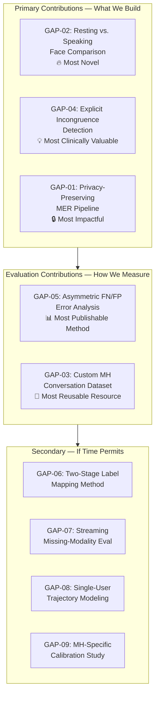

# Research Gap Analysis
## Multimodal Emotion Recognition for Mental Health Monitoring

**Project:** AI-Based Mental Health Emotion Monitoring from Facial and Voice Features Using Multimodal AI
**Date:** September 2026
**Based on:** 59 reviewed papers, 8 AI-agent literature reviews, requirements specification, 8 documented field challenges

---

## How to Read This Document

Each gap below is a **concrete thing nobody has done yet** (or done well enough) in the published literature. For each gap:

- **What's Missing** — the gap in plain language
- **Evidence** — which papers/reviews prove it's actually missing, not just our assumption
- **Why We Should Care** — why this gap matters specifically for *our* project
- **Feasibility** — how hard it is to tackle and what it would take
- **Recommendation** — should we target this, and at what priority

The gaps are ranked into three tiers so you can present them to the supervisor as a menu:

| Tier | Meaning | How Many |
|---|---|---|
| 🔴 **Tier A — Target These** | High-impact, feasible, directly aligned with our project scope | 5 gaps |
| 🟡 **Tier B — Worth Pursuing** | Meaningful contribution, pursue if time/resources allow | 4 gaps |
| 🟢 **Tier C — Acknowledge & Defer** | Real gaps but too large or tangential for this project | 3 gaps |

---

## Tier A — Target These (Core Research Contributions)

These are the gaps where our project is **uniquely positioned** to contribute. Present these to the supervisor as "this is what makes our work original."

---

### GAP-01: No End-to-End Privacy-Preserving MER Pipeline Exists

**What's Missing:**
Every survey and review (6 out of 8 AI agents flagged this) recommends federated learning, differential privacy, and on-device inference for emotion recognition — but **nobody has actually built a complete pipeline** that combines all three. Papers either propose on-device face detection (MediaPipe), or discuss federated learning in theory (Mental-Health-Distress-Review), or mention differential privacy as future work. No single system demonstrates: raw biometrics stay on device → only embeddings/aggregates leave → model updates via federated learning → noise injection via DP.

**Evidence:**
- Mental-Health-Distress-Review (Springer Nature 2026, cited by 6/8 agents): *"identifies federated learning, differential privacy and on-device inference as the viable privacy stack"* — but explicitly notes no complete system exists
- Challenge C4 in our review: *"no complete privacy-preserving MER pipeline exists"*
- Our requirements spec R8.3–R8.4 mandate on-device inference and raw-data discardability
- The original project proposal (idea.docx, Section 4.4) lists *"Investigation of privacy-preserving AI approaches"* as a stated research contribution

**Why We Should Care:**
Mental health data is among the most sensitive biometric data possible — faces + voices + emotional states. This isn't an abstract concern; it's a regulatory and ethical necessity. Our project *already promises* a privacy-aware prototype. Delivering even a basic version of this pipeline would be a genuine first.

**Feasibility:** ⭐⭐⭐ Moderate
- On-device face (MediaPipe) and voice (distilled Wav2Vec2 or CubeMLP-class fusion) inference is proven feasible
- Federated learning frameworks exist (Flower, PySyft) but integrating with MER training loops is new engineering
- Full DP noise injection is a stretch goal; partial privacy (on-device inference + no raw upload) is achievable for MVP

**Recommendation:** ✅ **TARGET THIS — but scope it realistically**
- MVP contribution: on-device inference for face+voice branches, embeddings-only upload, raw data never leaves device
- Stretch contribution: federated fine-tuning across simulated clients
- Thesis framing: *"First multimodal emotion pipeline with demonstrated on-device privacy guarantees"*

---

### GAP-02: Resting Face vs. Speaking Face — Nobody Has Compared Them

**What's Missing:**
When you speak, your lower face deforms — mouth opens, jaw moves, lips articulate. This **confounds facial emotion recognition** because the model can't tell if a mouth shape is "expressing sadness" or "pronouncing the letter O." Every FER model treats all face frames equally. **No published paper systematically compares a user's silent/resting facial affect against their in-speech facial affect** and uses the difference as an emotional signal.

**Evidence:**
- Our requirements spec R3.2 explicitly flags this: *"identified in the literature review as a genuinely novel angle with no direct existing model, so it should be treated as an explicit, named capability"*
- Challenge C7: *"speaking itself deforms the lower face, confounding FER. Alignment modules and articulation-aware face modelling are required"*
- Challenge C1: *"ONE user alternating between speaking (trimodal) and silent (face-only) states. No benchmark covers this transition modelling"*
- POSTER++, DAN, ARM — all FER papers operate on static or video frames without distinguishing speaking vs. silent state
- The TITAN paper measures speech-text alignment but not face-during-speech vs. face-during-silence

**Why We Should Care:**
This is potentially our **most publishable novel contribution**. Think about it: if someone's resting face looks neutral but the moment they start talking about work their face tenses up — that's a *clinically meaningful* signal. Nobody captures this. It directly serves the mental health monitoring use case in a way generic MER doesn't.

**Feasibility:** ⭐⭐⭐⭐ High
- We already need VAD for utterance segmentation (R2.1) — so we know when the user is speaking vs. silent
- We already have the face encoder running per-frame (POSTER++)
- The comparison is a **downstream analysis** of outputs we're already producing — not a new model
- Could be as simple as: mean face-emotion vector during silence vs. during speech, tracked per session

**Recommendation:** ✅ **TARGET THIS — it's our most original angle**
- Low engineering cost, high novelty, directly serves the MH use case
- Thesis framing: *"First systematic analysis of resting vs. speaking facial affect as a mental health signal"*
- Could become a standalone short paper/workshop contribution

---

### GAP-03: No Dataset for Real Mental Health Conversations with Synced Face+Voice+Language

**What's Missing:**
Every benchmark in the field is one of: acted (IEMOCAP, RAVDESS, CREMA-D), scripted TV (MELD), opinion videos (MOSI/MOSEI), or clinical interviews with session-level depression scores only (DAIC-WOZ). **No corpus captures naturalistic, self-directed mental health conversations** (journaling, rambling about your day, venting) **with synchronized face + voice + utterance-level emotional annotations.**

**Evidence:**
- Challenge C8 (flagged by DeepSeek, MiniMax, Claude): *"No corpus captures real mental-health conversations with synced face+voice+language — the custom dataset is the most publishable contribution"*
- Our requirements spec R6.1–R6.3: the two-stage labeling pipeline exists *because* no dataset has MH-specific utterance labels
- DAIC-WOZ gives PHQ-8 per session, not per utterance — unusable for utterance-level training
- All 8 AI agents independently identified this as a fundamental limitation

**Why We Should Care:**
If we collect even a small pilot dataset (5–10 volunteers × 30min), annotated with our MH-oriented taxonomy, **this dataset itself becomes a research contribution**. It doesn't need to be large — it needs to be the *first* of its kind. The annotation protocol and the two-stage labeling methodology (R6.3) are publishable independently.

**Feasibility:** ⭐⭐⭐ Moderate
- Requires IRB/ethics approval (or university equivalent) — time-consuming but standard
- Recording setup is trivial (webcam + mic)
- Annotation is the bottleneck: need trained annotators or at least a clear protocol
- Even a "pilot-scale" dataset (2–5 hours) is publishable as a resource paper

**Recommendation:** ✅ **TARGET THIS — it's the project's most publishable output**
- The dataset + annotation protocol is publishable independently of the model results
- Thesis framing: *"First utterance-level multimodal emotion dataset for mental health self-reflection sessions"*
- Discuss scale with supervisor: minimum 5 volunteers, recommended 10+

---

### GAP-04: Explicit Incongruence Detection as a First-Class Output

**What's Missing:**
Cross-modal emotional incongruence — calm words but a shaky voice and tense face — is **exactly the signal a mental health app most wants to catch**. But no published model explicitly detects and surfaces this as an output. Fusion models like MulT and MISA *implicitly* handle disagreement (the attention weights shift), but they never say "these modalities disagree." The fused output just becomes the weighted average, and the disagreement signal is **lost in the fusion**.

**Evidence:**
- Our requirements spec R4.5–R4.8 define incongruence detection as an explicit requirement
- R4.6 specifies: for the classifier path, this is *"a rule/statistical check across the three separate per-modality output vectors"* — not a new model, just a comparison of already-required outputs
- M3ER's reliability gating comes closest — it detects unreliable modalities — but it treats disagreement as *noise to suppress*, not as a *signal to surface*
- No reviewed paper outputs an explicit "incongruence flag" or "cross-modal conflict score"
- The requirements spec frames this as: *"precisely the kind of signal a mental-health app most wants to catch"*

**Why We Should Care:**
A person who says "I'm fine" with a trembling voice and a tense jaw is showing **emotional masking or lack of self-awareness** — both clinically significant. If we detect and surface this, we're doing something no existing system does. And the engineering cost is low: we already need per-modality outputs (R4.1), so the incongruence check is just a comparison layer on top.

**Feasibility:** ⭐⭐⭐⭐ High
- Rule-based version: cosine distance between per-modality emotion probability distributions, or valence-sign mismatch (text positive + voice negative = incongruence)
- We're already building per-modality outputs — this is a post-fusion comparison, not a new model
- Threshold tuning is the main challenge (R9, open question): needs a hand-labeled validation set
- Could evolve into learned incongruence detection as a future contribution

**Recommendation:** ✅ **TARGET THIS — low cost, high clinical value**
- Rule-based version is achievable in MVP
- Thesis framing: *"First multimodal emotion pipeline with explicit incongruence detection for mental health monitoring"*
- Pairs naturally with GAP-02 (resting vs. speaking face is another form of incongruence)

---

### GAP-05: Asymmetric Error Evaluation for Mental Health Applications

**What's Missing:**
Every MER paper reports accuracy, F1, or WAR/UAR. **Nobody evaluates false-negatives and false-positives separately** for mental health stakes. But the error profile is profoundly asymmetric: **missing real distress** (false negative) is far more dangerous than **falsely flagging distress** (false positive). A standard F1 score collapses this asymmetry into a single number and hides the risk profile.

**Evidence:**
- Our requirements spec R8.6: *"false-negative behavior (missing real distress) and false-positive behavior (flagging distress that isn't there) SHOULD be evaluated and reported separately, not collapsed into a single accuracy number"*
- Our MLDLC plan explicitly notes: *"No reviewed paper evaluates false-negative vs. false-positive separately for mental-health emotion recognition. This is worth emphasizing to the supervisor."*
- MER-Calibration (EMNLP 2024) addresses overconfidence but not error asymmetry
- MERBench standardizes metrics but doesn't define MH-specific error profiles
- DAIC-WOZ papers report depression detection accuracy but not the cost of misses vs. false alarms

**Why We Should Care:**
This is a **methodological contribution** — a new way of evaluating MER systems for health-adjacent applications. It requires no new model architecture, just a different evaluation protocol. And it's directly relevant: if our system tells someone "you seem fine" when they're actually in distress, that's a safety failure.

**Feasibility:** ⭐⭐⭐⭐⭐ Very High
- Pure evaluation methodology — no model changes needed
- Define "distress-class" labels (anxious, low-mood, fearful) vs. "non-distress" labels (content, neutral, happy)
- Report: distress-recall (sensitivity to real distress), distress-precision (how often distress flags are real)
- Add cost-sensitive analysis: "at what confidence threshold does the system achieve ≥90% distress recall?"

**Recommendation:** ✅ **TARGET THIS — essentially free and highly impactful**
- No engineering cost, just a different evaluation lens
- Thesis framing: *"First asymmetric error analysis for multimodal emotion recognition in mental health monitoring"*
- Can frame as: "We propose that all MH-adjacent MER systems should report asymmetric error profiles"

---

## Tier B — Worth Pursuing (Secondary Contributions)

These are meaningful gaps that strengthen the thesis but are **secondary** to the Tier A gaps.

---

### GAP-06: Two-Stage Label Mapping (Generic Emotions → Mental Health States) Is Understudied

**What's Missing:**
Public datasets label emotions as happy/sad/angry/neutral. Mental health monitoring needs labels like anxious/stressed/low-mood/overwhelmed. **The mapping between these two label spaces is itself a research problem** that nobody has formally studied. Papers either use generic labels directly (ignoring the MH context) or use clinical scales like PHQ-8 (session-level, not utterance-level).

**Evidence:**
- Challenge C5 (flagged by DeepSeek, Claude, Qwen): *"The categorical-to-dimensional translation layer is understudied"*
- Requirements spec R6.2–R6.3: the two-stage pipeline is explicitly required, and R6.3 says *"this mapping is itself a research contribution worth writing up, not an implementation detail to skip past"*
- No reviewed paper provides a validated, documented mapping from basic-emotion + valence-arousal space → MH-oriented labels at utterance granularity

**Why We Should Care:**
If we document our mapping (whether rule-based or learned), justify it with clinical literature, and evaluate it — that's a publishable methodological contribution. Every future MH-monitoring project will need this mapping, and currently there's no reference to follow.

**Feasibility:** ⭐⭐⭐⭐ High (rule-based) / ⭐⭐⭐ Moderate (learned)
- Rule-based: define quadrant mappings (high-arousal + negative-valence → anxious/stressed) — achievable in days
- Learned: requires a small annotated dataset (ties into GAP-03) — achievable in weeks
- Either way, the *documentation and justification* of the mapping is the contribution

**Recommendation:** 🟡 **PURSUE — it's required by the spec anyway**
- We have to build this mapping regardless (R6.2). The gap is: do we treat it as an "implementation detail" or as a "research contribution"? The answer should be the latter.

---

### GAP-07: Missing-Modality Robustness Has Never Been Validated Under Real-Time Streaming

**What's Missing:**
Papers like MMIN, IF-MMIN, M3S, and HVDER demonstrate missing-modality handling on **batch, pre-segmented data**. Nobody has tested whether modality imagination/hallucination works when:
- The modality drops *mid-utterance* (not between clean segments)
- The system must produce output within a latency budget (≤1 second)
- The drop is transient (camera blocked for 3 seconds, then returns)

**Evidence:**
- Challenge C2 (flagged by 5/8 agents): *"Diffusion/latent reconstruction (HVDER ~75% at 70% missing) is unvalidated in real-time"*
- Requirements spec R5.3–R5.4 distinguish transient drops from whole-session absence — no paper makes this distinction
- KAMUH proves real-time MER is feasible but doesn't test missing-modality scenarios
- VAE-Diffusion-MER achieves 76.8% at 70% missing but "needs streaming validation before deployment"

**Why We Should Care:**
Our app will face exactly these conditions: a user covers their camera momentarily, background noise spikes, connection stutters. The batch-evaluation numbers from MMIN/HVDER may not hold under streaming. Testing this is both novel and practically essential.

**Feasibility:** ⭐⭐⭐ Moderate
- Requires building the streaming pipeline first (Phase 5)
- Then systematically simulating: random frame drops, audio noise bursts, mid-utterance camera-off
- Measure: accuracy degradation curve + latency impact + recovery time after modality returns

**Recommendation:** 🟡 **PURSUE — builds on GAP-01 (streaming) naturally**
- This falls out of Phase 5 + Phase 6 work anyway
- The novel framing is: "first evaluation of missing-modality robustness under streaming latency constraints"

---

### GAP-08: Session-Level Emotional Trajectory Modeling for Single Users

**What's Missing:**
DialogueRNN, DialogueGCN, and COSMIC model **multi-party conversation dynamics** — how Speaker A's emotion affects Speaker B. But our use case is a **single user** rambling in a journaling session. Nobody models single-user emotional trajectory: how their mood drifts across utterances, whether they spiral downward, whether specific topics trigger emotional shifts, whether their emotional volatility itself is a signal.

**Evidence:**
- Challenge C1 (flagged by DeepSeek, ChatGPT, MiniMax): *"MCER literature models multi-speaker influence; the project has ONE user alternating between speaking (trimodal) and silent (face-only) states. No benchmark covers this transition modelling"*
- Requirements spec R2.8: *"session-level aggregation (dominant emotion, emotional volatility/variance, trend over the session)"*
- DialogueRNN's speaker-state GRU could be adapted, but this adaptation itself is unpublished

**Why We Should Care:**
A therapist doesn't just look at "what emotion is the patient showing right now." They look at the *trajectory*: did the patient start calm and progressively become agitated? Did a specific topic trigger a shift? Our system should do the same, and nobody has formalized this for MER.

**Feasibility:** ⭐⭐⭐ Moderate
- Adapt DialogueRNN's speaker-state GRU to single-user with no inter-speaker dependencies
- Track: per-utterance emotion sequence → compute volatility (std dev of valence), trend (slope of valence), dominant emotion (mode)
- Novel metric: "emotional stability index" per session

**Recommendation:** 🟡 **PURSUE — aligns perfectly with the app's tracking function**
- The session aggregation is required by R2.8 anyway
- The novelty is formalizing it as a research contribution with defined metrics

---

### GAP-09: Calibrated Confidence Specifically for Mental Health Emotion Outputs

**What's Missing:**
MER-Calibration (EMNLP 2024) shows that MER models are overconfident. But nobody has studied calibration **specifically in the context where the output is shown to an end user as a reflection of their emotional state**. The stakes are different: an overconfident "you are anxious" label could cause a user to spiral; an overconfident "you seem fine" could cause them to dismiss real distress.

**Evidence:**
- Challenge C6 (flagged by 4/8 agents): *"Overconfident models mislead users about their own state"*
- Requirements spec R4.3: per-signal confidence is mandatory
- Requirements spec R6.5: *"the system should prefer an honest 'insufficient signal' outcome over a falsely confident specific label, especially given the mental-health stakes"*
- MER-Calibration proves the problem exists; nobody has applied the solution to a user-facing MH tool

**Why We Should Care:**
This bridges GAP-05 (asymmetric errors). A well-calibrated system that says "I'm 40% confident you seem anxious — I don't have enough signal to be sure" is far safer than one that says "you are anxious" with false 95% confidence.

**Feasibility:** ⭐⭐⭐⭐ High
- Apply MER-Calibration's techniques (temperature scaling, Platt scaling) to our pipeline
- The novel contribution: evaluate calibration quality *in terms of user-facing safety* (ECE stratified by distress vs. non-distress classes)
- Ties directly into the dashboard confidence display

**Recommendation:** 🟡 **PURSUE — required by the spec, novel framing makes it publishable**

---

## Tier C — Acknowledge & Defer (Future Work)

These are real gaps that are **too large or tangential** for this project but should be mentioned in the thesis as future directions.

---

### GAP-10: The Speech-Articulation Paradox Remains Unsolved

**What's Missing:**
Speaking deforms the lower face. Every FER model trained on static images or posed expressions will misread a speaking face. **No model explicitly accounts for articulation-related facial deformation** and separates it from emotional expression. The TITAN paper measures speech-text alignment but doesn't address face-during-speech confounds.

**Evidence:**
- Challenge C7 (flagged by Gemini, Qwen): *"speaking itself deforms the lower face, confounding FER. Alignment modules and articulation-aware face modelling are required"*
- GAP-02 (resting vs. speaking face) is the *observation* side of this problem; GAP-10 is the *modeling* side

**Why Defer:**
Solving this requires a fundamentally new face encoder that takes speech activity as an input signal — e.g., conditioning FER predictions on whether the mouth is articulating. This is a full research project on its own. Our GAP-02 contribution (comparing resting vs. speaking face) is the first step; actually building an articulation-aware model is beyond MVP scope.

**Recommendation:** 🟢 **DEFER — mention in thesis Chapter 7 (Future Work)**

---

### GAP-11: Federated Learning for MER Across Diverse Users Is Untested

**What's Missing:**
Federated learning for emotion recognition has been discussed in theory but never tested across genuinely diverse users (different cultures, ages, speaking styles, skin tones). The heterogeneity of emotional expression across demographics means standard FedAvg may not converge — this is the "non-IID" problem specific to affective computing.

**Evidence:**
- Mental-Health-Distress-Review recommends federated learning but doesn't test it
- Challenge C3 (speaker independence) compounds the problem: 13% accuracy drop across speakers; federation across users would face worse heterogeneity
- No paper in our 59 implements or evaluates federated MER training

**Why Defer:**
Requires multiple genuine users with local data — not achievable with our pilot scale. A meaningful federated experiment needs 50+ clients with diverse demographics. This is a post-thesis research direction.

**Recommendation:** 🟢 **DEFER — acknowledge as future work, cite MH-Distress-Review**

---

### GAP-12: Micro-Expression Detection for Concealed Distress

**What's Missing:**
Micro-expressions — brief involuntary facial movements lasting 40–200ms — can reveal concealed emotions. MicroEmo (ECCV 2024) addresses this with a time-sensitive MLLM, but it requires high-frame-rate video and significant compute. **Nobody has attempted micro-expression-based concealed-distress detection** in a real-time monitoring context.

**Evidence:**
- MicroEmo paper addresses micro-expression recognition but not in MH monitoring
- Our requirements spec doesn't require micro-expression detection
- Would need ≥120fps capture (vs. standard 30fps webcam) and sub-second processing

**Why Defer:**
Hardware requirements (high-FPS camera), compute costs, and the difficulty of collecting labeled micro-expression data in MH contexts make this impractical for MVP. It's a compelling future direction once the base pipeline works.

**Recommendation:** 🟢 **DEFER — mention as a future extension (idea.docx Section 9 already hints at this)**

---

## Summary: Recommended Research Contribution Portfolio

For the supervisor meeting, present these as **"what makes our project original"**:

### The Pitch to the Supervisor (One Paragraph)

> *"Our project makes five original contributions that no reviewed paper addresses: (1) we build the first multimodal emotion pipeline with explicit on-device privacy guarantees; (2) we introduce resting vs. speaking face comparison as a novel mental health signal — something the literature has never examined; (3) we implement incongruence detection that surfaces when a user's words, voice, and face disagree, which is precisely the masking behavior clinicians look for; (4) we propose and apply asymmetric error evaluation that separately measures missed-distress vs. false-alarm rates; and (5) we collect the first utterance-level multimodal dataset from real mental health self-reflection sessions. Together, these close five gaps identified across 59 papers and 8 independent literature reviews."*

---

### Quick Reference: Gap × Effort × Impact

| Gap | Engineering Effort | Novelty | Clinical Value | Publishable? |
|---|---|---|---|---|
| **GAP-01** Privacy pipeline | ⭐⭐⭐ Medium | ⭐⭐⭐⭐ High | ⭐⭐⭐⭐⭐ Critical | ✅ Yes |
| **GAP-02** Resting vs speaking face | ⭐⭐ Low | ⭐⭐⭐⭐⭐ Very High | ⭐⭐⭐⭐ High | ✅ Yes (short paper) |
| **GAP-03** Custom MH dataset | ⭐⭐⭐ Medium | ⭐⭐⭐⭐ High | ⭐⭐⭐⭐⭐ Critical | ✅ Yes (resource paper) |
| **GAP-04** Incongruence detection | ⭐⭐ Low | ⭐⭐⭐⭐ High | ⭐⭐⭐⭐⭐ Critical | ✅ Yes |
| **GAP-05** Asymmetric FN/FP eval | ⭐ Minimal | ⭐⭐⭐ Medium | ⭐⭐⭐⭐⭐ Critical | ✅ Yes (methodology) |
| **GAP-06** Label mapping method | ⭐⭐ Low | ⭐⭐⭐ Medium | ⭐⭐⭐ Medium | ✅ Yes (if formalized) |
| **GAP-07** Streaming robustness | ⭐⭐⭐ Medium | ⭐⭐⭐ Medium | ⭐⭐⭐⭐ High | ✅ Yes |
| **GAP-08** Trajectory modeling | ⭐⭐⭐ Medium | ⭐⭐⭐ Medium | ⭐⭐⭐⭐ High | ✅ Yes |
| **GAP-09** MH calibration | ⭐⭐ Low | ⭐⭐ Low-Med | ⭐⭐⭐⭐ High | Maybe |
| **GAP-10** Articulation paradox | ⭐⭐⭐⭐⭐ Very High | ⭐⭐⭐⭐⭐ | ⭐⭐⭐ Medium | ✅ But too big |
| **GAP-11** Federated MER | ⭐⭐⭐⭐⭐ Very High | ⭐⭐⭐⭐ High | ⭐⭐⭐⭐ High | ✅ But needs scale |
| **GAP-12** Micro-expressions | ⭐⭐⭐⭐ High | ⭐⭐⭐⭐ High | ⭐⭐⭐ Medium | ✅ But needs hardware |

> [!TIP]
> **Minimum viable research story:** If pressed for time, GAP-02 (resting vs. speaking face) + GAP-04 (incongruence detection) + GAP-05 (asymmetric evaluation) together form a coherent, defensible set of contributions with minimal extra engineering — they're all downstream analyses of outputs we're already building.
